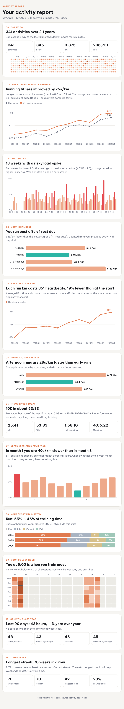

# activity-report: a free AI skill that finds what your fitness charts hide

> 🇻🇳 Bản tiếng Việt ở bên dưới.

Give Claude (or any agent that supports skills) your **Strava export, Garmin CSV, GPX/TCX/FIT files, or any activity CSV**. You get back one detailed HTML report, with charts and the insights a normal chart never shows you:

- **Your true fitness trend.** Raw pace looks slower when your runs get longer, so the skill converts every run to a 5K-equivalent pace.
- **Your ideal rest.** It finds how many rest days come before your best runs.
- **Heartbeats per km**, a simple measure of how efficient your heart is.
- **The best time of day for you**, and how much the season slows you down.
- **Risky load spikes** (acute:chronic workload over 1.5).
- **The month your habit really changed.** It finds the turning point automatically.
- Your golden hour, streaks, comebacks, year-over-year change and race predictions.



It is **100% free and open source**, and it runs locally: your data never leaves your computer. The only dependency is pandas.

## Use it as a skill

**Claude Code**

```bash
git clone https://github.com/ddylanx/activity-report-skill ~/.claude/skills/activity-report-repo
ln -s ~/.claude/skills/activity-report-repo/activity-report ~/.claude/skills/activity-report
```

Then ask: *"Analyse my Strava export in ~/Downloads/export_123"*.

**Claude.ai / Claude desktop**

1. Zip the `activity-report/` folder.
2. Upload it under Settings → Capabilities → Skills.
3. Attach your `activities.csv` in a chat.

## Or run it directly

```bash
pip install pandas                 # add fitdecode for .fit files
python activity-report/scripts/report.py path/to/export --tz 7 --lang en --out report.html
```

- `--tz`: your UTC offset. Strava stores UTC times.
- `--lang`: `en` or `vi`.
- `--limit`: the number of insights (default 12).

Try it on the bundled sample data:

```bash
python examples/make_sample.py examples/sample_activities.csv
python activity-report/scripts/report.py examples/sample_activities.csv --lang en --out examples/sample-report.html
```

## Get your Strava data

Strava → Settings → My Account → *Download or Delete Your Account* → *Request your archive*. Unzip the email attachment and point the skill at the folder.

---

## 🇻🇳 Tiếng Việt

Đưa cho Claude **file export Strava, CSV Garmin, file GPX/TCX/FIT hoặc bất kỳ file CSV hoạt động nào** (chạy bộ, đạp xe, đi bộ, cầu lông...). Bạn nhận lại một báo cáo HTML chi tiết, có chart và những insight mà chart thông thường không cho bạn thấy:

- **Thể lực thật**: quy mọi lần chạy về pace 5K tương đương, vì chạy xa hơn thì pace thô trông chậm hơn.
- **Số ngày nghỉ lý tưởng** trước những buổi chạy tốt nhất của bạn.
- **Số nhịp tim cho mỗi km**: tim bạn làm việc hiệu quả hơn hay kém đi.
- **Khung giờ bạn chạy nhanh nhất**, và mùa nào làm bạn chậm đi.
- **Những tuần tăng tải quá nhanh**, dễ chấn thương (ACWR > 1,5).
- **Tháng thói quen tập của bạn thực sự thay đổi**, được tìm tự động.

**Hoàn toàn miễn phí, mã nguồn mở**, chạy trên máy bạn nên dữ liệu không bị gửi đi đâu.

```bash
pip install pandas
python activity-report/scripts/report.py thu_muc_export_strava --tz 7 --lang vi --out bao-cao.html
```

Hoặc cài làm skill cho Claude (xem phần trên), rồi nhắn: *"Phân tích dữ liệu Strava của mình trong thư mục này"*.

## License

MIT
